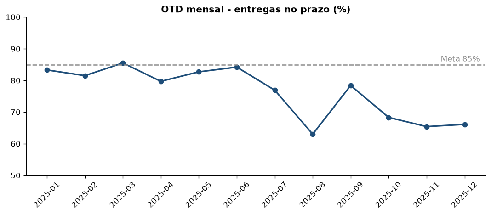
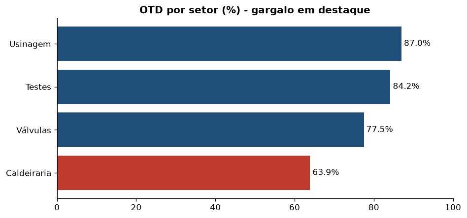
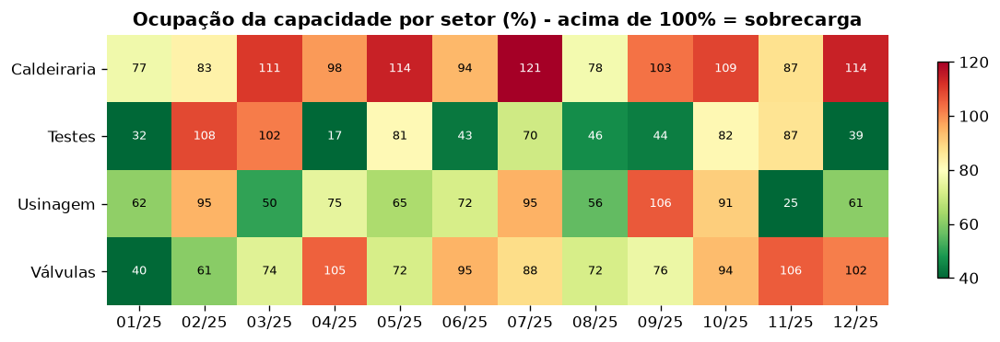
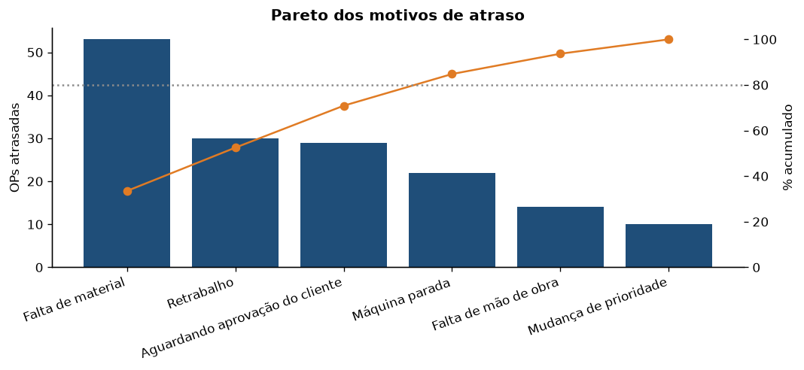

# 📊 Dashboard de PCP: Controle de Ordens de Produção

Análise de desempenho do **Planejamento e Controle da Produção (PCP)** de uma empresa de manutenção industrial (válvulas, caldeiraria, usinagem e testes), com **SQL, Python e Power BI**.

> ⚠️ **Dados fictícios.** A base foi gerada por script (`src/gerar_dados.py`) para reproduzir situações reais de chão de fábrica. Nenhuma informação pertence a uma empresa real.

---

## 🎯 Problema de negócio
A gestão precisava responder:
1. **Estamos entregando no prazo?** Como o OTD (*On Time Delivery*) evoluiu no ano?
2. **Onde está o gargalo?** Qual setor mais atrasa e qual está acima da capacidade?
3. **Por que atrasamos?** Quais motivos concentram a maior parte dos atrasos?
4. **Quem é mais afetado?** Quais clientes sofrem mais com atrasos?

## 🧰 Ferramentas
| Etapa | Ferramenta |
|---|---|
| Geração e tratamento dos dados | Python (pandas, numpy) |
| Modelagem e consultas | SQL (SQLite): CTEs, funções de janela, agregações |
| Visualização | Matplotlib · Power BI (medidas DAX em [`powerbi/medidas_dax.md`](powerbi/medidas_dax.md)) |

## 🗂️ Estrutura
```
├── data/            # ordens_producao.csv (650 OPs) e setores.csv
├── sql/
│   ├── 01_schema.sql      # modelo de dados
│   └── 02_analises.sql    # consultas analíticas
├── src/
│   ├── gerar_dados.py     # gera a base fictícia
│   └── analise.py         # roda o SQL e gera os gráficos
├── powerbi/medidas_dax.md # passo a passo + medidas DAX
└── img/                   # gráficos gerados
```

## 📈 Indicadores do ano (2025)
| OPs | OTD | Atraso médio | Eficiência de horas | Backlog |
|---|---|---|---|---|
| 650 | **76,0%** (meta 85%) | 7,3 dias | 96,5% | 4 OPs |

### 1. OTD caiu no 2º semestre

O OTD ficou perto da meta até junho (79–86%) e caiu para **63–78% de julho a dezembro**, quando a demanda aumentou.

### 2. Caldeiraria é o gargalo


A Caldeiraria tem o **pior OTD (63,9%)**, o **maior lead time (14,3 dias)** e ficou **acima de 100% da capacidade em 6 dos 12 meses**.

### 3. Três motivos explicam 71% dos atrasos

**Falta de material (33,5%)**, **retrabalho (19,0%)** e **aguardando aprovação do cliente (18,4%)** somam 70,9% dos atrasos.

## 💡 Recomendações
1. **Falta de material:** integrar PCP e Compras, com solicitação de material disparada na abertura da OP e alerta de prazo de fornecedor.
2. **Caldeiraria:** nivelar a carga (sequenciamento por capacidade) e avaliar hora extra ou terceirização nos meses de pico.
3. **Retrabalho:** registrar a causa raiz por OP e criar checklist de qualidade antes do teste.
4. **Aprovação do cliente:** definir um SLA de resposta no orçamento e acompanhar OPs paradas há mais de 2 dias.
5. **Indicador diário:** publicar o OTD e o backlog por setor no início do turno.

## ▶️ Como executar
Os dados e os gráficos são gerados **automaticamente pelo GitHub Actions** (`.github/workflows/gerar.yml`) a cada alteração no código, o que garante que a análise é reproduzível. Para rodar localmente:
```bash
pip install -r requirements.txt
python src/gerar_dados.py   # (opcional) regenera a base
python src/analise.py       # roda as consultas e gera os gráficos
```

---
👤 **Domingos Morato**: PCP & Análise de Dados · [LinkedIn](https://www.linkedin.com/in/domingos-morato)
